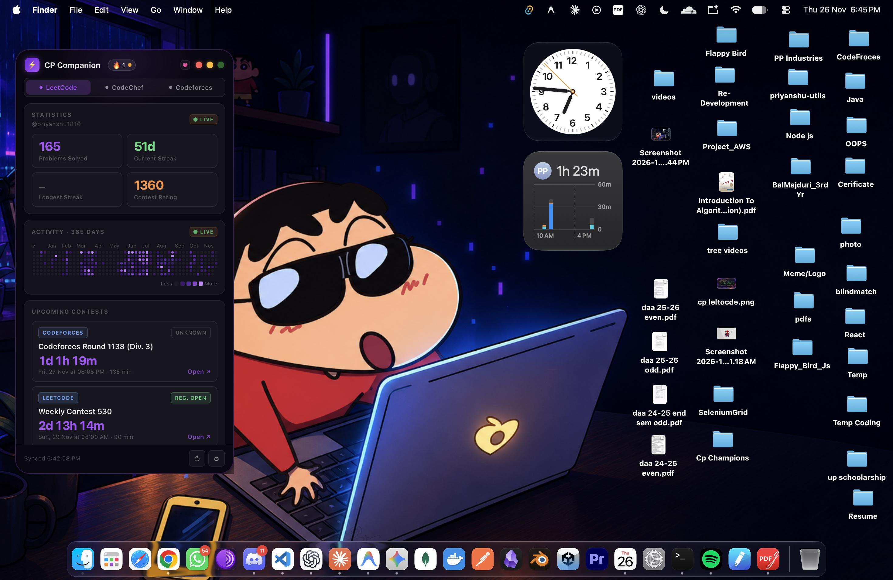
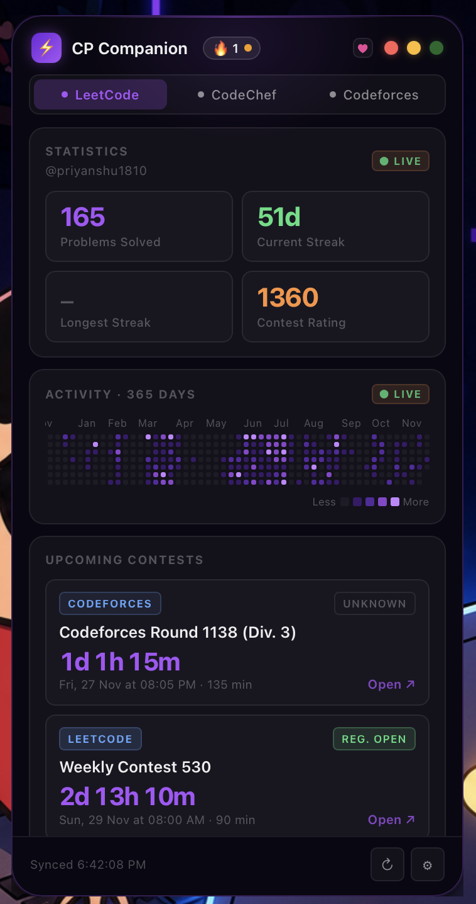

# CP Companion

**Your competitive programming progress, always on your desktop.**

One small widget for your LeetCode, CodeChef and Codeforces stats, activity heatmap and upcoming contests. Free and open source for macOS and Windows.






## Why

If you do competitive programming, you probably open three different sites every day just to see where you stand. CP Companion puts that in one widget that sits on your desktop and refreshes by itself.

## Features

- **Stats from all 3 platforms:** solved problems, ratings and ranks from LeetCode, CodeChef and Codeforces
- **365-day activity heatmap** built from your real submissions
- **Upcoming contests** with a live countdown
- **Starts with your computer** and lives in the menu bar (Mac) or system tray (Windows)
- **Movable, resizable, adjustable opacity**, and it remembers its position
- **Auto-update:** the app checks for new versions and asks before installing
- **Offline-friendly:** shows your last saved data if a site is unreachable

## Download

| Platform | File |
|---|---|
| macOS (Apple Silicon and Intel) | `CP.Companion_x.y.z_universal.dmg` |
| Windows (64-bit) | `CP.Companion_x.y.z_x64-setup.exe` or `.msi` |

**[Go to the Releases page](https://github.com/priyanshu-18/cp-companion/releases)** and download the file for your system.

> Do **not** download "Source code (zip / tar.gz)". That is only for developers. You don't need a terminal or any code to use the app.

### First launch (the app is not code-signed yet)

**macOS:** open the `.dmg`, drag CP Companion to Applications. Right-click the app, choose **Open**, then **Open** again. If macOS still blocks it, go to System Settings > Privacy & Security and click **Open Anyway**.

**Windows:** run the installer. If SmartScreen appears, click **More info**, then **Run anyway**.

These warnings appear once because I don't have paid Apple/Microsoft signing certificates yet. Everything is open source, so you can read the code or build it yourself.

## Quick start

1. Open CP Companion.
2. Open Settings and enter your handles for LeetCode, CodeChef and Codeforces (any one is enough).
3. Done. Your stats, heatmap and contests appear.

## How it works

CP Companion is built with **Tauri 2** (Rust) and **React + TypeScript**. The Rust backend fetches data from the LeetCode GraphQL endpoint, the official Codeforces API and the public CodeChef profile page. The UI is React with Zustand for state. Your handles and cached data are stored locally on your machine.

## Known limitations

- **CodeChef has no public API.** I read the public profile page, so it can break if CodeChef changes its site.
- **Windows is lightly tested.** In pin-to-desktop mode, Win+D may hide the widget.
- **LeetCode's calendar uses UTC days**, so late-night submissions in some time zones can land on a different day.
- **Unsigned app warnings** on first launch (see above).

Found a bug? [Open an issue](https://github.com/priyanshu-18/cp-companion/issues).

## Build from source

Requirements: Node.js 20+, Rust (stable), and the [Tauri 2 prerequisites](https://tauri.app/start/prerequisites/) for your OS.

```bash
git clone https://github.com/priyanshu-18/cp-companion.git
cd cp-companion
npm install
npm run tauri dev      # run in development
npm run tauri build    # build an installer
```

## Contributing

Issues and pull requests are welcome. See [CONTRIBUTING.md](CONTRIBUTING.md). Good first contributions: fixing the CodeChef parser when the site changes, new platforms (AtCoder, HackerRank), and Windows testing.

## Support

If CP Companion helps your practice:

- Star the repo on GitHub
- [Support on Ko-fi](https://ko-fi.com/impropriyanshu)

## License

GPL-3.0. See [LICENSE](LICENSE).

Copyright (C) 2026 Priyanshu Pandey

## Disclaimer

CP Companion is an independent project and is not affiliated with or endorsed by LeetCode, CodeChef or Codeforces. All trademarks belong to their respective owners.
